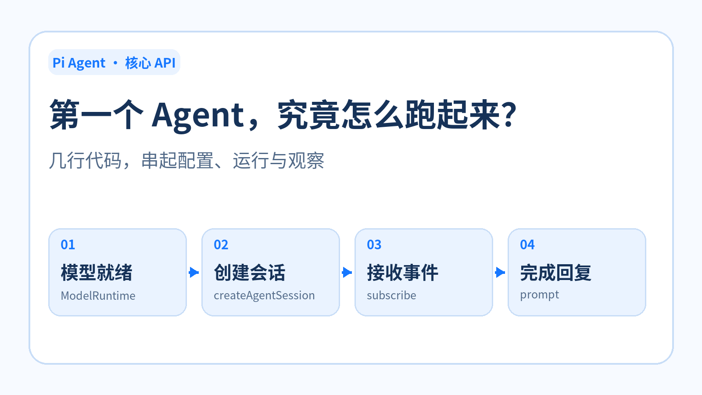
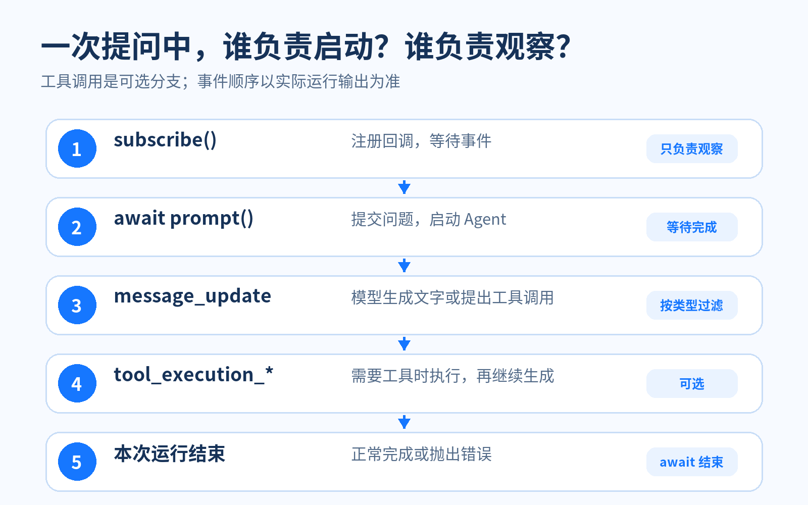
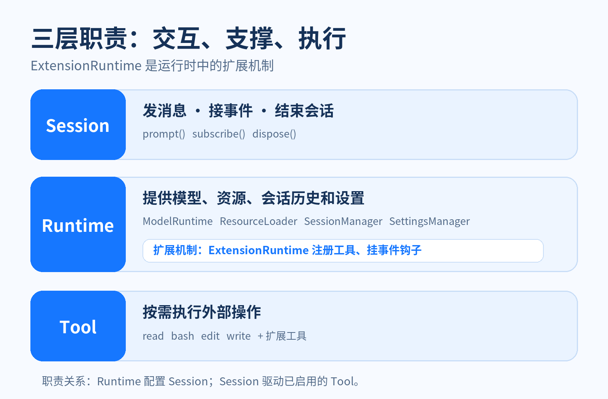

# <font color="#1677FF">从 12 行代码读懂 Pi Agent：核心 API、三层架构与工具调用</font>

我是安徽最忧郁程序员无隅



@[TOC](目录)

## <font color="#1677FF">前言</font>

> 第一个 Agent 已经跑通，但 `ModelRuntime.create()`、`createAgentSession()`、`subscribe()` 和 `prompt()` 分别做了什么？如果只知道它们的调用顺序，下一步改模型、接工具时仍然容易找错入口。本文以 `@earendil-works/pi-coding-agent` **0.87.1** 为例，沿一次提问拆解这些 API，再用 Session、Runtime、Tool 三层职责把它们串起来。读完你应当能判断：一项需求要改会话调用、运行时配置，还是工具能力。

## <font color="#1677FF">一、沿着最小示例走一遍</font>

先看能独立运行的版本。示例假设你已安装 `@earendil-works/pi-coding-agent`，并在 Pi 中配置过可用的模型认证；运行目录是你打算交给 Agent 处理的目录。把代码保存为 `hello.ts`，沿用上一章已安装的 `tsx`，运行 `npx tsx hello.ts`。[官方 SDK 文档](https://github.com/earendil-works/pi/blob/v0.87.1/packages/coding-agent/docs/sdk.md)也使用“创建会话 → 提问 → 清理”的顺序。

```typescript
import { createAgentSession, ModelRuntime } from "@earendil-works/pi-coding-agent";

const modelRuntime = await ModelRuntime.create();
const model = (await modelRuntime.getAvailable())[0];
if (!model) throw new Error("没有可用模型，请先配置模型认证");

const { session } = await createAgentSession({ model, modelRuntime });

try {
  session.subscribe((event) => {
    if (
      event.type === "message_update" &&
      event.assistantMessageEvent.type === "text_delta"
    ) {
      process.stdout.write(event.assistantMessageEvent.delta);
    }
  });

  await session.prompt("用一句话介绍你自己。");
  process.stdout.write("\n");
} finally {
  session.dispose();
}
```

这段代码有一条清晰的主线：**准备模型 → 创建会话 → 订阅过程 → 发起提问 → 释放会话**。代码比“12 行”略长，是因为补上了“没有可用模型”的检查和异常时的清理；这两处能让示例更适合作为后续练习的起点。

`ModelRuntime.create()` 建立模型与认证的管理对象。默认情况下，它结合 Pi 的认证存储、自定义模型配置和内置 Provider 定义；这里的 `await` 涉及异步初始化。**它默认不会主动刷新远端模型目录**，但不宜把它概括成“所有相关操作绝不联网”：后续的可用性检查可能与认证方式有关。具体创建逻辑可对照 [0.87.1 版源码](https://github.com/earendil-works/pi/blob/v0.87.1/packages/coding-agent/src/core/model-runtime.ts)。

`getAvailable()` 返回当前认证条件下可选择的模型。认证不只可能来自 API Key，也可能是已登录的其他方式；“在列表中”表示 SDK 判断它具备可用的认证条件，**不保证下一次远端请求一定成功**。示例直接取第一个模型，并在空列表时提前报错。若要指定某个模型，可在结果中匹配 `provider` 和 `id`，这两个字段一起标识模型，同时处理找不到的情况。[模型选择与认证说明](https://github.com/earendil-works/pi/blob/v0.87.1/packages/coding-agent/docs/models.md)可用于核对具体配置。

`createAgentSession({ model, modelRuntime })` 接过已选模型和运行时，返回的对象里包含最常用的 `session`，以及扩展加载结果等信息。显式传入这两个参数的好处是：你知道这一轮对话选了哪个模型；不传时，工厂也会根据设置和现有认证尝试选模型。[工厂函数源码](https://github.com/earendil-works/pi/blob/v0.87.1/packages/coding-agent/src/core/sdk.ts)展示了默认组件的创建顺序。

## <font color="#1677FF">二、会话怎样执行：观察与等待是两件事</font>

`session.subscribe(callback)` 注册一个监听器，并返回取消订阅函数。注册完成不等于 Agent 已经开始回答；在示例里，真正提交问题的是随后的 `session.prompt(...)`。因此要看流式文字，**先订阅，再提问**。回调只筛出 `message_update` 中的 `text_delta`，把新增的文字写到终端；其他事件仍可能发生，只是这段代码没有显示它们。[官方事件订阅示例](https://github.com/earendil-works/pi/blob/v0.87.1/packages/coding-agent/docs/sdk.md#subscribing-to-events)使用相同的筛选方式。

`await session.prompt(...)` 提交这条消息，并等待这次运行结束。如果模型决定使用工具，它会先给出工具调用，SDK 执行工具、把结果交回模型，模型再决定下一步；这个过程可以出现多轮。这里说的“等待”是 **Promise 尚未完成**，并非把 Node.js 线程卡住。运行也可能抛错，所以需要 `try/finally`。对于运行中再次提交的新消息，SDK 还有明确的排队规则；本例只讨论空闲会话的一次提问。[Prompting 文档](https://github.com/earendil-works/pi/blob/v0.87.1/packages/coding-agent/docs/sdk.md#prompting)解释了完成条件和运行中提问的限制。

下图把“注册监听”和“启动运行”分开。请留意第 4 步：工具调用是可选的，实际事件数量、顺序取决于模型这次做出的决定。



`session.dispose()` 用于结束这个会话对象的使用：它会中止活跃工作、移除监听并清理会话级资源，因此放在 `finally` 中。**释放会话对象不等于删除已持久化的历史记录**；历史是否落盘由 `SessionManager` 决定。[会话生命周期文档](https://github.com/earendil-works/pi/blob/v0.87.1/packages/coding-agent/docs/sdk.md#session-lifecycle)说明了两者的边界。

## <font color="#1677FF">三、三层职责：Session、Runtime、Tool</font>

把 API 逐个记下来还不够。以后要改系统提示词、会话存储或工具时，先问“这属于哪一层”，通常比搜索某个方法名更快。下图按**职责**排布，并不表示代码按从上到下的顺序执行。



**Session 是交互入口。** `prompt()` 发消息，`subscribe()` 看过程，`dispose()` 结束使用。同一个 Session 可以连续提问，后一次提问会建立在已有会话上下文上。换一个全新 Session 则是另一段对话；如果要继续旧历史，需要通过会话存储机制恢复，不能仅靠保留某个变量。[会话与存储说明](https://github.com/earendil-works/pi/blob/v0.87.1/packages/coding-agent/docs/sdk.md#session-storage)对此有明确区分。

**Runtime 是本文的职责分组，**指会话创建时依赖的一组运行时组件，并非需要额外实例化的单一 `Runtime` 类：

| 组件 | 负责什么 | 改动时通常找它 |
| --- | --- | --- |
| `ModelRuntime` | 模型目录、认证与模型调用 | 切换模型或接入 Provider |
| `ResourceLoader` | 加载系统提示词、扩展、skills 等资源 | 调整 Agent 的指令与扩展来源 |
| `SessionManager` | 管理会话条目和历史恢复 | 决定历史落盘还是只放内存 |
| `SettingsManager` | 提供合并后的运行设置 | 调整默认模型、工具等设置 |

`createAgentSession()` 未收到这些组件时，会创建默认实现。默认 `SessionManager` 把会话写入 Pi 的会话目录；如果宿主程序不想写会话文件，可传入 `SessionManager.inMemory()`。在 Web 服务中，还要自行设计每段对话的标识、存储和访问隔离，不能把“使用内存模式”误认为已经完成多用户持久化。[SDK 配置说明](https://github.com/earendil-works/pi/blob/v0.87.1/packages/coding-agent/docs/sdk.md#configuring-a-session)列出了可替换的边界。

**Tool 是 Agent 执行外部操作的能力。** 在未改动工具设置时，默认启用 `read`、`bash`、`edit`、`write`；也可以通过 `tools` 等选项调整，或由扩展注册新工具。工具启用以后，是否调用、调用哪一个，由模型根据问题与上下文决定。因此，一句“请读文件”不保证一定出现工具事件，实验时要看实际事件输出。[工具配置示例](https://github.com/earendil-works/pi/blob/v0.87.1/packages/coding-agent/examples/sdk/05-tools.ts)展示了如何显式选择工具。

原始材料的“三层图”又画出 `ExtensionRuntime`，容易让人以为有第四层。按本文的阅读模型，它属于**运行时里的扩展机制**：扩展通过 `pi.registerTool()` 注册工具，通过 `pi.on()` 挂事件钩子。最终注册的工具仍归入 Tool 能力，钩子则参与运行过程；无需把它和 Session、Runtime、Tool 并列成第四层。[扩展文档](https://github.com/earendil-works/pi/blob/v0.87.1/packages/coding-agent/docs/extensions.md)给出了这两个 API 的用途。

## <font color="#1677FF">四、打印事件，验证一次工具调用</font>

理解三层职责后，可以做一个小实验：把第一节的订阅回调替换为下面这段，再把提问改为读取项目的 `package.json`。请在含有该文件的项目目录运行；示例只读取文件，不修改它。

```typescript
session.subscribe((event) => {
  if (
    event.type === "message_update" &&
    event.assistantMessageEvent.type === "text_delta"
  ) {
    process.stdout.write(event.assistantMessageEvent.delta);
    return;
  }
  console.log(`[${event.type}]`);
});

await session.prompt("请先用 read 工具读取当前目录的 package.json，再告诉我 name 字段的值。");
```

这段代码仍会逐字输出回答，同时打印其他事件类型。如果这次确实调用了工具，你应能在日志里找到 `tool_execution_start` 与 `tool_execution_end`；在它们之后，通常还会有模型继续生成的事件。若没有看到工具事件，先检查工具是否启用，再检查模型是否真的选择了工具。**“提问需要工具”是我们的预期；“工具事件出现”才是本次运行的观察结果。**

这里打印的只是 `event.type`，不足以知道工具名称或参数；具体字段和更完整的事件处理适合留到 Web 集成时再展开。此处需要带走的关系是：`subscribe()` 把运行过程交给应用观察，`prompt()` 启动并等待这一轮，Runtime 提供模型与资源，Tool 在需要时执行操作。

如果接下来要换模型，先看 `ModelRuntime`；要改系统提示词，找 `ResourceLoader`；要新增操作，配置或注册 Tool；要把过程实时送到页面，从 Session 的事件订阅入手。
