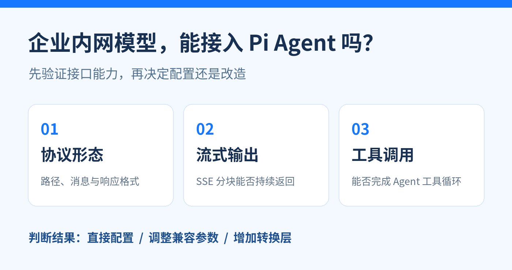
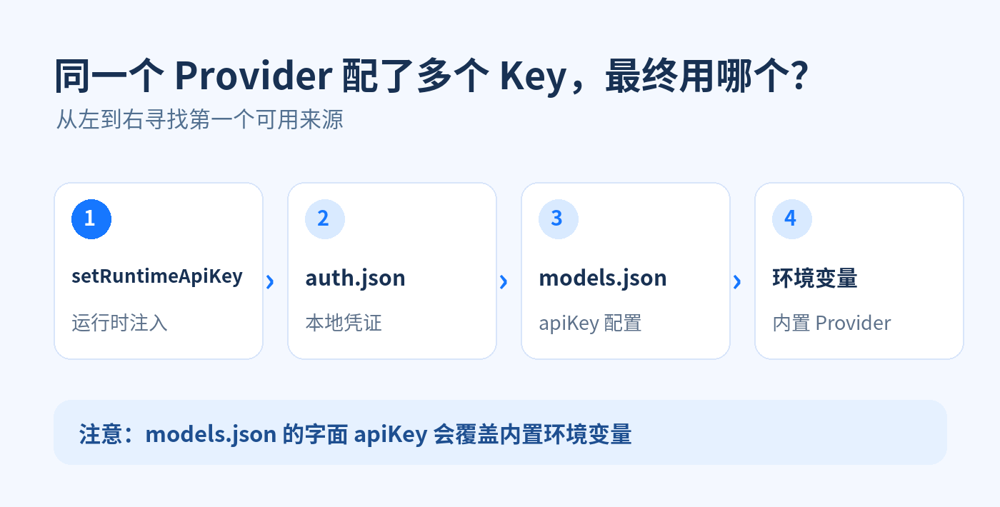
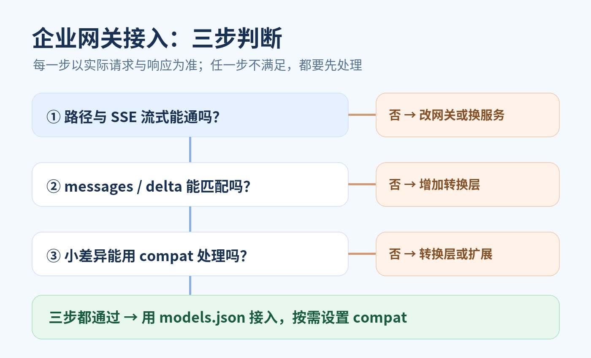

# <font color="#1677FF">企业内网模型能接入 Pi Agent 吗？从模型配置到接口兼容性判断</font>

我是安徽最忧郁程序员无隅



@[TOC](目录)

## <font color="#1677FF">前言</font>

> 企业模型平台说自己“兼容 OpenAI”，把地址填进 Pi Agent 后却可能报 400、收不到流式输出，或者只能聊天、不能调用工具。接入前真正需要确认的是：**Pi 发出的请求和网关返回的流，能否组成完整的 Agent 对话**。本文以 Pi `v0.87.1` 的配置与 SDK 为例，给出从模型配置、密钥管理到接口核对和改造方案的判断方法。

## <font color="#1677FF">一、先跑通模型配置</font>

Pi 已内置的 Provider，通常先用 `/login` 配凭证、用 `/model` 选模型。只有接企业网关、本地服务或尚未内置的端点时，才需要在 `~/.pi/agent/models.json` 里增加自定义 Provider。Pi 官方的[模型连接说明](https://github.com/earendil-works/pi/blob/v0.87.1/packages/coding-agent/docs/models.md)也是按这个顺序组织的。

下面用一个**示意性的企业网关**说明配置结构。`apiKey` 引用运行 Pi 的进程环境变量；实际接入时，`baseUrl` 和模型 `id` 都要以网关文档和测试结果为准。

```json
{
  "providers": {
    "enterprise": {
      "baseUrl": "https://llm.example.com/v1",
      "api": "openai-completions",
      "apiKey": "$INTERNAL_LLM_KEY",
      "models": [
        {
          "id": "internal-chat",
          "name": "企业聊天模型",
          "contextWindow": 128000,
          "maxTokens": 16384
        }
      ]
    }
  }
}
```

这里有三层含义：`enterprise` 是 Provider 名；`api` 选择 Pi 用哪套协议组装请求和解析响应；`models` 列出该 Provider 可选的模型。`provider/id` 组合用于定位模型，例如 `enterprise/internal-chat`。若模型支持图像或推理，再依据真实能力补 `input`、`reasoning` 等元数据，不能仅凭名称猜测。对自定义模型，`name` 可省略；`contextWindow` 和 `maxTokens` 有默认值，但应尽量填写服务端真实限制，否则上下文压缩和输出上限的判断可能与网关不一致。[配置实现](https://github.com/earendil-works/pi/blob/v0.87.1/packages/coding-agent/src/core/provider-composer.ts)

SDK 中，**找到模型对象**和**模型已有可用凭证**是两回事。`getModel()` 只按 Provider 和 ID 查找；切换会话模型时，`setModel()` 还会检查目标 Provider 的鉴权。如果没有 Key，切换会报错。已有会话切换模型后，后续请求使用新模型，原有对话记录继续留在会话中。[ModelRuntime 源码](https://github.com/earendil-works/pi/blob/v0.87.1/packages/coding-agent/src/core/model-runtime.ts)、[AgentSession 源码](https://github.com/earendil-works/pi/blob/v0.87.1/packages/coding-agent/src/core/agent-session.ts)

```typescript
const target = modelRuntime.getModel("enterprise", "internal-chat");
if (!target) throw new Error("请检查 models.json 中的 Provider 和模型 ID");

await session.setModel(target); // 目标 Provider 无凭证时会报错
await session.prompt("请概括这段文档");
```

这段代码适用于已经创建好 `modelRuntime` 和 `session` 的 SDK 程序。切换前先判空，也让“模型未定义”和“模型没有凭证”成为两个可区分的问题。

## <font color="#1677FF">二、管好 API Key：四种来源如何生效</font>

配置好了模型，还要让 Pi 找到对应的凭证。常见来源有四种：运行时注入、`auth.json`、`models.json` 中的 `apiKey`、内置 Provider 对应的环境变量。**同一 Provider 出现多个来源时，优先级从高到低依次如下图**。这是 Pi `v0.87.1` 的默认解析顺序；扩展注册的 Provider 可以有自己的鉴权逻辑。[官方模型文档](https://github.com/earendil-works/pi/blob/v0.87.1/packages/coding-agent/docs/models.md)



这个顺序最容易踩的坑是：给内置 Provider 同时设置了环境变量，又在 `models.json` 中写了字面 `apiKey`，最终会使用 `models.json` 的值。若希望密钥只由环境注入，可以使用 `"apiKey": "$INTERNAL_LLM_KEY"` 这样的显式插值；**自定义 Provider 名不会自动推出一个同名环境变量**。Pi 官方文档也支持 `${NAME}` 形式和按请求执行的凭证命令，但先用简单的环境插值更容易排查。[官方示例](https://github.com/earendil-works/pi/blob/v0.87.1/packages/coding-agent/docs/models.md)

本地开发时，`/login` 写入的 `auth.json` 适合集中管理凭证；`models.json` 则只保留可公开的模型定义。两类文件都要按实际内容决定是否纳入版本控制，**含真实密钥的配置文件不要提交仓库**。

如果 SDK 程序需要在启动后注入 Key，使用 `setRuntimeApiKey()`，并等待异步操作完成：[SDK 凭证示例](https://github.com/earendil-works/pi/blob/v0.87.1/packages/coding-agent/examples/sdk/09-api-keys-and-oauth.ts)。

```typescript
const key = process.env.INTERNAL_LLM_KEY;
if (!key) throw new Error("缺少 INTERNAL_LLM_KEY");
await modelRuntime.setRuntimeApiKey("enterprise", key);
```

运行时覆盖属于 `ModelRuntime` 的凭证状态；多用户服务不能把所有用户的 Key 依次写进一个共享 Runtime，然后假定它会自动按会话隔离。

## <font color="#1677FF">三、判断内网接口能否直连</font>

“OpenAI 兼容”常常只表示网关能接受一部分 OpenAI 风格的请求。Pi 的 `openai-completions` 路线会按 Chat Completions 方式发送消息，并读取**流式分块**；OpenAI 官方的[Chat Completions 接口说明](https://developers.openai.com/api/reference/cli/resources/chat)可用来理解端点与消息结构，但**企业网关是否真正支持这些字段，仍以实际测试为准**。

先核对下面四项，再谈 `compat`：

| 核对项 | 需要从文档和实际响应确认什么 | 失败时的含义 |
| --- | --- | --- |
| 端点 | `baseUrl` 后能否拼出 `/chat/completions`；不要把完整端点直接填作 `baseUrl` | 路径不符，需要调整网关路由或加转换层 |
| 鉴权 | 网关要求 Bearer Key、其他请求头，还是签名流程 | 先核对 `apiKey`、`headers`；签名流程可能需要扩展 |
| 流式输出 | 请求 `stream: true` 后，是否持续返回 `data: {...}` 形式的 SSE 分块 | 没有流式能力，不能仅靠 `compat` 补出真实流 |
| 消息与响应 | 是否接受 `messages` 的角色和内容；文本是否在流式 `choices[].delta` 中返回 | 字段或角色体系不同，需要做协议转换 |
| 工具循环 | 是否接受 `tools`，能否返回 `tool_calls`，并接受下一轮的工具结果 | 只能完成普通聊天，不能直接承担 Pi 的工具型 Agent |

可以先在 Postman 或企业网关调试工具中发一个**最小文本请求**，把以下 JSON 作为请求体；端点、鉴权头和模型 ID 使用企业文档给出的真实值。这里的示例是核对格式，**不是对某个企业服务已经成功调用的记录**。

```json
{
  "model": "internal-chat",
  "messages": [
    { "role": "user", "content": "请回复：连接成功" }
  ],
  "stream": true
}
```

成功时，应观察到一段段可解析的流式事件，而不只是最后一次性收到完整 JSON。然后再加 `tools` 做第二次测试，并把返回的 `tool_calls` 和工具结果送入下一轮；**只测通一句问答，尚不能证明 Agent 能用**。如果普通文本已报 `404`，先查路径；报 `401/403`，先查鉴权；报字段错误的 `400`，再看兼容参数。[Pi 请求组装实现](https://github.com/earendil-works/pi/blob/v0.87.1/packages/ai/src/api/openai-completions.ts)

一个容易误判的地方是：Pi 不会对所有服务固定发送同一套可选参数。在 `v0.87.1` 的实现里，`stream: true` 是这条协议的基本请求方式；`stream_options`、`store`、`max_completion_tokens`、`tools` 等则受到兼容设置、调用选项或当前工具集影响。排查时应以**实际请求体**为准，不能把示意请求当成每次调用的完整模板。[Pi 源码](https://github.com/earendil-works/pi/blob/v0.87.1/packages/ai/src/api/openai-completions.ts)

## <font color="#1677FF">四、差异怎么处理：先改配置，再考虑转换层</font>

前面的核对不是为了得到一个笼统的“兼容/不兼容”标签，而是为了分清：差异只是某个字段，还是整个协议形态都不同。下图把处理路线放在一起；**前两项检查没有通过时，不能跳过它们直接调 `compat`**。



`compat` 适合已经能完成主要请求与响应、只在少数字段上有差异的网关。比如网关只认旧的输出上限字段，或者拒绝 `stream_options`，可以在对应模型的定义中按测试结果增加开关：

```json
{
  "id": "internal-chat",
  "name": "企业聊天模型",
  "compat": {
    "maxTokensField": "max_tokens",
    "supportsUsageInStreaming": false
  }
}
```

上面是**模型条目的片段**，放在 `models.json` 的 `models` 数组中，并非完整文件。`maxTokensField` 只在请求设置输出上限时决定发送哪个字段；`supportsUsageInStreaming: false` 会停止请求流式 usage，适合网关因 `stream_options` 报错的情况，但不会凭空得到用量统计。`supportsDeveloperRole`、`supportsReasoningEffort` 等也应只在观察到对应差异后设置。特别是 `supportsStore`、`supportsStrictMode` 的默认值会按端点或模型能力处理，**不要机械地把原文中的一组开关全部复制过去**。[Pi 兼容字段定义](https://github.com/earendil-works/pi/blob/v0.87.1/packages/ai/src/types.ts)、[请求构造实现](https://github.com/earendil-works/pi/blob/v0.87.1/packages/ai/src/api/openai-completions.ts)

如果网关使用特殊路径、完全不同的消息结构或非标准流式事件，`compat` 不负责把整套协议翻译过去。此时可以让网关提供标准端点，或者在中间放一层转换服务：把 Pi 的请求转成网关格式，再把网关的流式响应转回 Pi 所选协议的格式。转换层要处理**双向**转换；只改请求、不改返回流，通常仍无法完成对话。

协议长期自成体系时，还可以写 Pi 的 Provider 扩展。Pi 官方建议：已有协议能表达时继续复用内置实现；只有需要自定义流、动态模型发现或特殊鉴权时，才增加 Provider 实现。[自定义 Provider 文档](https://github.com/earendil-works/pi/blob/v0.87.1/packages/coding-agent/docs/custom-provider.md)

## <font color="#1677FF">五、明确边界：没有工具调用会失去什么</font>

有些模型可以稳定流式聊天，却不支持工具调用。此时可在 SDK 中清空活动工具，让后续请求不再携带当前工具定义：[AgentSession 实现](https://github.com/earendil-works/pi/blob/v0.87.1/packages/coding-agent/src/core/agent-session.ts)。

```typescript
session.setActiveToolsByName([]);
```

这能让一个**纯聊天场景**继续使用该模型，但会话里的 `read`、`bash`、`edit`、`write` 等工具也无法被模型调用，自定义工具同样不会执行。原有对话如果包含工具调用历史，网关仍可能因历史消息格式报错，因此还要用新会话或实际历史记录测试。[Pi 请求构造实现](https://github.com/earendil-works/pi/blob/v0.87.1/packages/ai/src/api/openai-completions.ts)

真正的 Agent 工具循环包括：模型提出工具调用、程序执行工具、把结果送回模型、模型继续回答。**清空工具集相当于主动放弃这条循环**。如果业务必须依赖工具，而模型或网关根本不会产生可靠的工具调用，转换层也无法创造模型本身没有的能力；应换支持工具调用的模型或升级网关。基于提示词约定“输出一段 JSON 当工具调用”可以作为自建方案，但需要自己实现解析、校验、执行和循环，不能当作 Pi 原生工具调用的等价替代。

回到开头的问题：企业内网模型**能否接入 Pi Agent**，答案取决于你要它完成什么。普通聊天先验证路径、鉴权和流式；工具型 Agent 再验证完整工具循环。主体协议已通时，`models.json` 加少量 `compat` 就够；协议形态不同时，需要网关改造、转换层或 Provider 扩展。这个判断应来自实际请求和响应，而不是接口文档上的“兼容”两个字。
